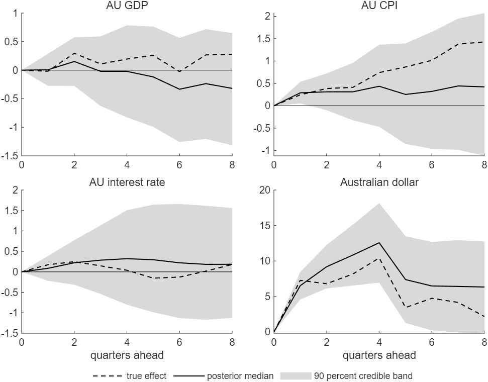

# How to Forecast a Small Open Economy under a Foreign Scenario

*Code: [`guide.m`](guide.m), with [`bvar.models.var_soe`](../../core/+bvar/+models/var_soe.m),
[`bvar.forecast.predictive`](../../core/+bvar/+forecast/predictive.m),
[`bvar.forecast.mixquantile`](../../core/+bvar/+forecast/mixquantile.m) and
[`bvar.util.shaded_band`](../../core/+bvar/+util/shaded_band.m). Method:
[Cushman and Zha (1997)](../../CITING.md#cushman-and-zha-1997),
[Zha (1999)](../../CITING.md#zha-1999),
[Waggoner and Zha (1999)](../../CITING.md#waggoner-and-zha-1999) and
[Chan (2027)](../../CITING.md#chan-2027). Data: [`soe_Q.csv`](../data/).*

How would the outlook for Australia change if the US excess bond premium stayed one percentage
point above its baseline for a year? We use the [small open economy VAR](../soe_var/) to compare
two eight-quarter forecasts. Both fix the paths of the four US variables. The scenario raises the
premium in the first four quarters and leaves the other US paths unchanged.

Because the Australian variables do not enter the US equations, we can run the Australian block
forward with the US paths as inputs. We illustrate the method with 141 quarters simulated from a
VAR fitted to US and Australian data. This lets us check the estimated scenario effects against
the model that generated the sample.

In that model, the Australian dollar depreciates relative to the baseline by 7.27 log points in
the first quarter and 10.43 log points after a year. The guide shows how to compute credible bands
for the change in the forecast mean and predictive bands for future outcomes. In this example,
fixing the US path narrows the 90 percent predictive bands for the Australian variables by 4 to 29
percent at the horizons reported.

To reproduce the numbers and the figure, open guide.m and click Run, or type in the Command Window
from the root of the repository:

```matlab
run guides/soe_conditional_forecast/guide.m
```

## The Scenario

The forecast starts at the end of the sample and runs eight quarters ahead. The baseline path of
the US variables is their unconditional forecast: the posterior mean of the forecasts of the 10,000
draws. In the baseline, the premium rises from 0.45 to 0.77 percentage points and then falls to
0.34. The scenario raises the premium one point above this path in the first four quarters. The
other three US variables stay on their baseline paths.

The effect of the scenario on an Australian variable is the difference between two forecasts: the
forecast given the scenario and the forecast given the baseline path. Because the other US
variables stay on their baseline, the effect is that of the premium path alone. A structural shock
to the premium also moves the other US variables. In
[How to Trace a Foreign Shock through a Small Open Economy](../soe_foreign_shock/), it lowers US
GDP and the federal funds rate.

## Step 1: Forecast the Australian Variables Given the US Path

The Australian block of the estimation guide is a regression on the current US variables and on
all lags:

```math
\mathbf{y}^d_t = \mathbf{c} + \mathbf{G}_0\mathbf{y}^f_t + \sum_{j=1}^{p}\left(\mathbf{G}_j\mathbf{y}^f_{t-j} + \mathbf{D}_j\mathbf{y}^d_{t-j}\right) + \mathbf{e}_t, \qquad \mathbf{e}_t \sim \mathcal{N}(\mathbf{0}, \boldsymbol{\Omega}),
```

where $`\mathbf{e}_t`$ is independent of the US errors. Given a draw of the parameters and the
full US path, the errors $`\mathbf{e}_t`$ are the only source of uncertainty. The mean forecast
runs the regression forward with $`\mathbf{e}_t = \mathbf{0}`$. Its regressors are the US values
of the path and the Australian forecasts of the earlier quarters. The forecast error $`h`$
quarters ahead is $`\sum_{i=0}^{h-1}\boldsymbol{\Psi}_i\mathbf{e}_{T+h-i}`$, with covariance
matrix $`\sum_{i=0}^{h-1}\boldsymbol{\Psi}_i\boldsymbol{\Omega}\boldsymbol{\Psi}_i'`$, where
$`\boldsymbol{\Psi}_0 = \mathbf{I}`$ and
$`\boldsymbol{\Psi}_i = \sum_{j=1}^{\min(i,p)}\mathbf{D}_j\boldsymbol{\Psi}_{i-j}`$.

The function `cond_forecast` at the end of `guide.m` computes the mean and the standard deviations
from the reduced form of a draw. It recovers $`\mathbf{G}_0`$ and $`\boldsymbol{\Omega}`$ from the
error covariance matrix $`\boldsymbol{\Sigma}`$:

```matlab
G0 = Sig(au, us)/Sig(us, us);            % the projection of the Australian errors on the US errors
Om = Sig(au, au) - G0*Sig(us, au);       % the covariance of the remainder
```

In each quarter, it takes the one-step forecast `yh` of the reduced form, replaces the US values
with those of the path and moves the Australian mean with them:

```matlab
    y(us) = yf(h, :)';                                   % the US values on the path
    y(au) = yh(au) + G0*(y(us) - yh(us));                % the Australian mean given them
```

The result is the mean of the Australian block above. The US equations exclude the Australian
lags, so the coefficients of the Australian equations on the Australian lags are the same
$`\mathbf{D}_j`$ in the reduced form. The matrices $`\boldsymbol{\Psi}_i`$ therefore follow from
the reduced form:

```matlab
    for l = 1:min(h-1, p), Psi(:, :, h) = Psi(:, :, h) + Phi(au, au, l)*Psi(:, :, h-l); end
    V = V + Psi(:, :, h)*Om*Psi(:, :, h)';
```

## Step 2: Compute the Effect for Every Draw

[`bvar.models.var_soe`](../../core/+bvar/+models/var_soe.m) takes the 10,000 draws of the
estimation guide in one call:

```matlab
res = bvar.models.var_soe(Yfull(1:q0, :), Yfull(q0+1:end, :), p, nus, 'lev', lev, 'c3', c3, ...
    'nsim', R);
```

The method of Waggoner and Zha (1999) computes the distribution of forecasts given a path for some
of the variables of a VAR. It draws the parameters from their posterior given both the data and
the path. Here the draws given the data alone give the same distribution of the Australian
forecasts. Given a path for all four US variables, the forecast depends only on the parameters of
the Australian block. The path enters the likelihood only through the US block, and given the
hyperparameters, the two blocks have independent priors. The posterior of the Australian block is
therefore the same with or without the path.

[`bvar.forecast.predictive`](../../core/+bvar/+forecast/predictive.m) gives the mean and the
standard deviation of the unconditional forecast of every draw. The baseline path is the mean of
the US forecasts over the draws, and the scenario adds one point to the premium:

```matlab
[mu_u, sd_u] = bvar.forecast.predictive(res.A, res.Sig, ylag, H);   % unconditional, R x n x H
yf_base = squeeze(mean(mu_u(:, us, :), 1))';   % the baseline US path: the mean forecast, H x nus
yf_scen = yf_base;
yf_scen(1:4, 4) = yf_scen(1:4, 4) + 1;    % the scenario: the premium one point higher for a year
```

Each draw then gives two conditional forecasts and their difference:

```matlab
for r = 1:R
    A = reshape(res.A(r, :), k, n); Sig = squeeze(res.Sig(r, :, :));   % draw r
    [m_base(:, :, r), s_base(:, :, r)] = cond_forecast(A, Sig, ylag, yf_base, us, au);
    m_scen(:, :, r) = cond_forecast(A, Sig, ylag, yf_scen, us, au);
end
eff = level(m_scen - m_base, ig);         % the effect of the scenario, levels for growth rates
```

As in the shock guide, the function `level` turns the effects on the three growth rates into
effects on the levels of GDP, the CPI and the exchange rate. These effects are in log points, 100
times the change in the log level. They are large enough here for log points and percent to
differ. A depreciation of 10.43 log points means that the Australian dollar buys 9.90 percent
fewer US dollars. The table gives the effects in the true model and the posterior median after
four quarters, with the pointwise 90 percent credible band.

| Effect on | True, 1 quarter | True, 4 quarters | True, 8 quarters | Posterior, 4 quarters |
|---|---|---|---|---|
| Australian GDP, log points | -0.02 | 0.19 | 0.28 | -0.02 (-0.83, 0.79) |
| Australian CPI, log points | 0.24 | 0.74 | 1.43 | 0.44 (-0.47, 1.36) |
| Australian interest rate, percentage points | 0.17 | 0.04 | 0.18 | 0.32 (-0.80, 1.51) |
| Australian dollar, log points | 7.27 | 10.43 | 2.18 | 12.57 (6.95, 18.15) |

We note three results in the true model. First, the Australian dollar depreciates by 7.27 log
points in the first quarter and by 10.43 after a year. After the premium returns to its baseline,
the dollar recovers most of the depreciation, and the effect is 2.18 log points after two years.
Second, Australian CPI is 1.43 log points higher after two years. Third, the effects on Australian
GDP and the interest rate are small, at most 0.30 log points and 0.25 percentage points.

The 90 percent credible bands from the sample contain the true effects on all four variables at
all eight horizons (Figure 1). The bands are wide. After a year, the band of the effect on the
dollar runs from 6.95 to 18.15 log points.



*Figure 1: The effects on the Australian variables of a US excess bond premium one percentage
point above its baseline in quarters 1 to 4, with the other US variables at their baseline. The
dashed line is the true effect, and the posterior median and the pointwise 90 percent credible
band come from the sample. The effects on GDP, the CPI and the Australian dollar are in log points
of their levels, and a positive effect on the dollar is a depreciation. The interest rate is in
percentage points.*

## Step 3: Compare the Predictive Bands

The US path also narrows the forecasts of the Australian variables. Predictive bands describe the
future values themselves, so they include the future errors as well as the uncertainty about the
parameters. Given the path, the forecast of each draw is Gaussian, with the mean and the standard
deviation of `cond_forecast`. The predictive distribution is the mixture over the draws, whose
quantiles [`bvar.forecast.mixquantile`](../../core/+bvar/+forecast/mixquantile.m) computes. The
unconditional forecast is the mixture of the Gaussian forecasts of `bvar.forecast.predictive`:

```matlab
        wid(i, h, 1) = diff(bvar.forecast.mixquantile(mu_u(:, au(i), h), sd_u(:, au(i), h), ...
            [.05 .95]));
        wid(i, h, 2) = diff(bvar.forecast.mixquantile(m_base(i, h, :), s_base(i, h, :), ...
            [.05 .95]));
```

Each cell of the table gives the width of the 90 percent band without the US path, its width with
the baseline path and, in parentheses, the reduction in percent. The variables are as they enter
the VAR: annualized growth rates and the interest rate in percent.

| Variable | 1 quarter | 4 quarters | 8 quarters |
|---|---|---|---|
| Australian GDP growth | 8.11, 7.72 (4.9) | 8.78, 7.96 (9.4) | 9.08, 8.04 (11.4) |
| Australian CPI inflation | 7.19, 6.70 (6.8) | 8.70, 7.93 (8.9) | 9.58, 8.47 (11.6) |
| Australian interest rate | 2.19, 2.10 (4.2) | 6.56, 5.84 (10.9) | 10.11, 8.35 (17.4) |
| Depreciation of the Australian dollar | 64.20, 53.69 (16.4) | 73.84, 54.47 (26.2) | 75.40, 53.63 (28.9) |

The US path removes the uncertainty about the US variables, and the reduction is larger at longer
horizons. It is largest for the Australian dollar, whose band is 16 percent narrower after one
quarter and 29 percent narrower after eight.

## How We Check It

<details>
<summary>The joint forecast conditioned on the path, and each draw's own US forecast</summary>

Given a draw, the forecast of all eight variables over the eight quarters is Gaussian, with a
stacked mean and covariance matrix. The function `joint_conditional` at the end of `guide.m`
conditions it on the US path with the formulas of the conditional normal distribution. For the
true model and the first five draws, its means and standard deviations agree with those of
`cond_forecast` to within 1.4e-13.

The conditional mean at the mean of the conditioning variables is the unconditional mean. Given
each draw's own unconditional forecast of the US variables as the path, `cond_forecast` therefore
returns the unconditional forecast of the Australian variables. For the first 100 draws the two
agree exactly.

</details>

## Adapt It Yourself

A stress test puts the premium on the path it followed in 2008 and 2009, when it reached 3.29
percentage points. Which lines of `guide.m` change?

<details>
<summary>Answer</summary>

Only the scenario path. Rows 97 to 104 of the data contain 2008Q1 to 2009Q4:

```matlab
yf_gfc = yf_base;
yf_gfc(:, 4) = data(97:104, 4);           % the premium in 2008Q1-2009Q4
```

The loop of Step 2 then runs with `yf_gfc` in place of `yf_scen`. The other US variables stay at
their baseline, so the stress test again isolates the premium. In the data, US GDP growth was
negative in four of these eight quarters, and the federal funds rate fell from 3.18 to 0.12
percent.

After a year, the Australian dollar depreciates by 19.47 log points in the true model. The
posterior median is 19.24, with a 90 percent credible band from 13.46 to 25.00. Australian CPI is
0.88 log points higher, against a posterior median of 0.82. The bands contain the true effects on
the four variables at every horizon but one, the effect on the dollar after two quarters.

</details>

## Next

[Can I Use Many Sign Restrictions in My Large VAR?](../../tutorials/sign_restrictions/) identifies
shocks by the signs of their effects, with no assumption about their order.

## Using This Method in Your Research

The VAR with block exogeneity for a small open economy follows Cushman and Zha (1997), and the
posterior draws block by block follow Zha (1999). The forecasts given a path follow Waggoner and
Zha (1999). Chan (2027) gives a textbook treatment of the natural conjugate prior and of
forecasting with VARs. [`CITING.md`](../../CITING.md) lists the paper behind each function of the
toolkit and how to cite the toolkit itself.

## References

Chan, J. C. C. (2027). *Bayesian Macroeconometrics: Methods and Applications*. Chapman &
Hall/CRC. [Code repository](https://github.com/joshuaccchan/bayesian-macroeconometrics)

Cushman, D. O. and Zha, T. (1997). Identifying Monetary Policy in a Small Open Economy under
Flexible Exchange Rates. *Journal of Monetary Economics*, 39(3): 433-448.
[doi:10.1016/S0304-3932(97)00029-9](https://doi.org/10.1016/S0304-3932(97)00029-9)

Waggoner, D. F. and Zha, T. (1999). Conditional Forecasts in Dynamic Multivariate Models.
*Review of Economics and Statistics*, 81(4): 639-651.
[doi:10.1162/003465399558508](https://doi.org/10.1162/003465399558508)

Zha, T. (1999). Block Recursion and Structural Vector Autoregressions. *Journal of Econometrics*,
90(2): 291-316. [doi:10.1016/S0304-4076(98)00045-1](https://doi.org/10.1016/S0304-4076(98)00045-1)
