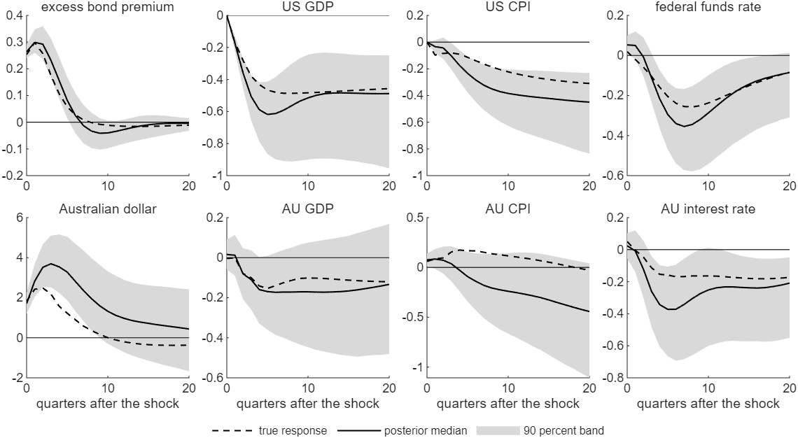

# How to Trace a Foreign Shock through a Small Open Economy

*Code: [`guide.m`](guide.m), with [`bvar.models.var_soe`](../../core/+bvar/+models/var_soe.m),
[`bvar.structural.irf_redu`](../../core/+bvar/+structural/irf_redu.m),
[`bvar.structural.fevd`](../../core/+bvar/+structural/fevd.m) and
[`bvar.util.shaded_band`](../../core/+bvar/+util/shaded_band.m). Method:
[Gilchrist and Zakrajšek (2012)](../../CITING.md#gilchrist-and-zakrajšek-2012),
[Cushman and Zha (1997)](../../CITING.md#cushman-and-zha-1997),
[Zha (1999)](../../CITING.md#zha-1999) and [Chan (2027)](../../CITING.md#chan-2027). Data:
[`soe_Q.csv`](../data/).*

[How to Estimate a VAR for a Small Open Economy](../soe_var/) treats Australia as the small open
economy and the US as the foreign economy. Its VAR has a foreign block of US variables and a
domestic block of Australian variables. Every US shock can move the Australian variables, and no
Australian shock moves a US variable. In this guide we trace one US shock through the eight
variables: a rise in the excess bond premium of Gilchrist and Zakrajšek (2012). They interpret
this rise as a contraction in the supply of credit.

As in the estimation guide, the true model is a VAR with block exogeneity fitted to US and
Australian data. We simulate a sample of 141 quarters from the true model, the same sample as in
the estimation guide. The true responses to the shock are then known, and the posterior can be
compared with them. We identify the shock recursively within the US block and compute its effects
for every draw from the posterior of that guide.

In the true model, a shock of one standard deviation raises the premium by 0.25 percentage points.
US GDP is 0.43 percent lower after a year. The Australian dollar depreciates by 1.83 percent in
the quarter of the shock, and Australian GDP is 0.14 percent lower after a year. In this sample,
the posterior bands contain the true responses of four of the eight variables at every horizon.
The posterior median overstates the depreciation of the Australian dollar after a year, 3.54
percent against the true 1.58.

To reproduce the numbers and the figure, run the following command from the root of the
repository:

```matlab
run guides/soe_foreign_shock/guide.m
```

## The Shock

The reduced-form errors $`\mathbf{u}_t`$ of the VAR have covariance matrix
$`\boldsymbol{\Sigma}`$. A recursive identification writes them as
$`\mathbf{u}_t = \mathbf{L}\boldsymbol{\varepsilon}_t`$. The matrix $`\mathbf{L}`$ is lower
triangular with $`\mathbf{L}\mathbf{L}' = \boldsymbol{\Sigma}`$, and the shocks
$`\boldsymbol{\varepsilon}_t`$ are independent with unit variances. The identifying assumption is
then the order of the variables. A shock can move the variables after it within the quarter. It
can move the variables before it only from the next quarter on.

Gilchrist and Zakrajšek (2012) estimate a VAR of eight US variables. They order the excess bond
premium after their measures of activity and inflation, and before the stock market return and the
interest rates. A shock to the premium then affects activity and inflation with a lag, and the
other variables can respond within the quarter. We keep this relative order in the smaller US
block: GDP growth, CPI inflation, the premium and the federal funds rate. The Australian variables
come after the US block. The shock can therefore move all four of them within the quarter, through
the matrix $`\mathbf{G}_0`$ of the estimation guide. An Australian shock has no effect on a US
variable at any horizon. The order excludes an effect within the quarter, and block exogeneity
excludes an effect at later horizons.

## Step 1: Compute the Responses to the Shocks

The function `responses` at the end of `guide.m` takes the Cholesky factor in the recursive order
and puts its rows back in the order of the data:

```matlab
L = chol(Sig(ord, ord), 'lower');        % the impact matrix in the recursive order
L(ord, :) = L;                           % its rows back in the order of the data
resp = bvar.structural.irf_redu(A(2:end, :), L, H, size(Sig, 1));
```

Column $`j`$ of `L` contains the effects of shock $`j`$ on the eight variables within the quarter.
[`bvar.structural.irf_redu`](../../core/+bvar/+structural/irf_redu.m) then gives the effects at
later horizons: `resp(i, j, h + 1)` is the response of variable $`i`$ to shock $`j`$ after $`h`$
quarters. A response is the difference between the path of a variable after the shock and its path
without the shock. The premium is the fourth column of the data and the third variable of the
recursive order:

```matlab
ord = [1 2 4 3 5:n];                      % the recursive order: the premium before the funds rate
js = 3;                                   % the premium shock in that order
ig = [1 2 5 6 8];                         % the variables in growth rates
```

Five variables enter as annualized growth rates: GDP growth and CPI inflation in both countries,
and the depreciation of the Australian dollar. Each is 400 times the change in the logarithm of a
level. The function `level` cumulates their responses and divides by four:

```matlab
x(ig, :) = cumsum(x(ig, :), 2)/4;
```

The result is the response of the level in log points times 100. It is close to the response in
percent when the response is small, and we report it in percent. The exchange rate is the number
of Australian dollars per US dollar, so a positive response is a depreciation of the Australian
dollar. The responses of the two interest rates and the premium stay in percentage points.

## Step 2: Compute the Responses for Every Draw

Each draw of the reduced form gives one set of responses, so the 10,000 draws of the estimation
guide give their posterior. [`bvar.models.var_soe`](../../core/+bvar/+models/var_soe.m) takes them
in one call, with the steps of that guide:

```matlab
res = bvar.models.var_soe(Yfull(1:q0, :), Yfull(q0+1:end, :), p, nus, 'lev', lev, 'c3', c3, ...
    'nsim', R);
```

As in that guide, the marginal likelihood of the sample is largest at $`c_1 = 0.070`$. Each row
of `res.A` and of `res.Sig` contains one draw:

```matlab
for r = 1:R
    resp = responses(reshape(res.A(r, :), k, n), squeeze(res.Sig(r, :, :)), ord, H);
    irf_d(:, :, r) = level(squeeze(resp(:, js, :)), ig);
    share = bvar.structural.fevd(resp);
    fev_d(:, r) = share(:, js, 8);                      % the premium shock, 8 quarters ahead
    us_au = max(us_au, max(abs(resp(us, au, :)), [], 'all'));   % US variables, Australian shocks
end
qirf = quantile(irf_d, [.05 .5 .95], 3);  % the median and the 90 percent band
```

The table gives the responses to a shock of one standard deviation in the true model. Its last
column gives the posterior median after four quarters, with the pointwise 90 percent band.

| Response of | True, on impact | True, 4 quarters | True, 8 quarters | Posterior, 4 quarters |
|---|---|---|---|---|
| Excess bond premium, points | 0.25 | 0.11 | 0.00 | 0.16 (0.09, 0.24) |
| US GDP, percent | 0.00 | -0.43 | -0.49 | -0.59 (-0.79, -0.42) |
| US CPI, percent | 0.00 | -0.09 | -0.19 | -0.17 (-0.29, -0.06) |
| Federal funds rate, points | 0.02 | -0.16 | -0.26 | -0.22 (-0.36, -0.07) |
| Australian dollar, percent | 1.83 | 1.58 | 0.36 | 3.54 (2.24, 5.16) |
| Australian GDP, percent | 0.00 | -0.14 | -0.11 | -0.16 (-0.33, 0.00) |
| Australian CPI, percent | 0.06 | 0.17 | 0.14 | -0.03 (-0.24, 0.19) |
| Australian interest rate, points | 0.05 | -0.15 | -0.16 | -0.34 (-0.61, -0.10) |

We note three results in the true model. First, US activity falls and US monetary policy eases. US
GDP is 0.43 percent lower after a year, and the federal funds rate is 0.26 points lower after two
years. Second, the Australian dollar is 1.83 percent weaker on impact and 2.48 percent weaker
after two quarters. The depreciation is temporary: after two years the dollar is 0.36 percent
weaker than on the path without the shock. Third, the effect on Australian activity is small.
Australian GDP is 0.14 percent lower after a year, a third of the fall in US GDP. The Australian
interest rate is 0.15 points lower.

The posterior from the sample of 141 quarters agrees with the true model for four variables
(Figure 1). Its bands contain the true responses of the premium, US GDP, Australian GDP and the
Australian interest rate at all 21 horizons. It differs most for the Australian dollar and
Australian CPI. The posterior median response of the dollar after a year is 3.54 percent, more
than twice the true 1.58. The band lies above the true response between two and eight quarters
after the shock. The posterior median response of Australian CPI after a year is -0.03 percent,
and the true response is 0.17 percent. The band lies below the true response between five and
eight quarters. The bands also miss the true response of US CPI at four horizons and that of the
federal funds rate at one.



*Figure 1: The responses to a shock of one standard deviation to the US excess bond premium, in
the true model and in the posterior from the sample. The bands are pointwise 90 percent bands.
GDP, the CPI and the Australian dollar are in percent of their levels, and a positive response of
the dollar is a depreciation. The interest rates and the premium are in percentage points.*

## Step 3: Measure How Much the Shock Explains

The shock is one of eight. Its share of the forecast error variance of variable $`i`$ over eight
quarters is a ratio. The numerator is the sum of its squared responses over horizons 0 to 7. The
denominator is the same sum over all eight shocks. The shares refer to the variables as they enter
the VAR. [`bvar.structural.fevd`](../../core/+bvar/+structural/fevd.m) computes these shares at
every horizon from the responses to all eight shocks. The loop of Step 2 keeps those of the
premium shock eight quarters ahead.

| Variable | True share, percent | Posterior median and 90 percent band |
|---|---|---|
| US GDP growth | 16.2 | 28.6 (17.1, 41.9) |
| US CPI inflation | 4.9 | 7.7 (2.9, 15.6) |
| Federal funds rate | 7.1 | 13.3 (3.6, 28.5) |
| Excess bond premium | 79.4 | 74.4 (59.0, 86.7) |
| Australian GDP growth | 1.9 | 4.3 (1.5, 9.3) |
| Australian CPI inflation | 1.8 | 5.8 (1.8, 13.7) |
| Australian interest rate | 1.8 | 9.6 (1.2, 25.9) |
| Depreciation of the Australian dollar | 15.2 | 18.0 (10.9, 27.1) |

In the true model the shock explains 16.2 percent of the variance for US GDP growth and 15.2
percent for the depreciation of the Australian dollar. It explains less than 2 percent for each of
the other Australian variables. The posterior medians of these small shares exceed the true
values. A share cannot be negative, so its posterior is skewed to the right when the true share is
close to zero.

## How We Check It

<details>
<summary>A simulation of the VAR, the other order and the Australian shocks</summary>

The responses of the true model equal a simulation of the VAR after the shock, with every other
shock at zero, to within 2e-15.

The order of the premium and the federal funds rate matters little. With the premium after the
funds rate, the largest change in a true response is 0.09, for the Australian dollar in percent.

No Australian shock moves a US variable. The responses of the four US variables to the four
Australian shocks are exactly zero at every horizon in all 10,000 draws.

</details>

## Adapt It Yourself

A scenario often fixes the size of the shock: a rise of one percentage point in the premium, say.
Which lines of `guide.m` change?

<details>
<summary>Answer</summary>

Divide the responses of each draw by its own response of the premium on impact, and then take the
quantiles:

```matlab
irf_pp = irf_d./irf_d(4, 1, :);           % each draw divided by its response of the premium
qpp = quantile(irf_pp, [.05 .5 .95], 3);
```

The size of a shock of one standard deviation differs across the draws. Dividing the bands of Step
2 by one number would ignore that uncertainty. After four quarters, a rise of one point in the
premium lowers US GDP by 2.23 percent. The 90 percent band runs from 1.60 to 2.92. In the true
model the fall is 1.70 percent. Australian GDP is 0.61 percent lower, against 0.56 in the true
model. Its band runs from a fall of 1.23 percent to a rise of 0.01 percent.

</details>

## Next

[How to Forecast a Small Open Economy under a Foreign Scenario](../soe_conditional_forecast/)
forecasts the Australian variables given a path for the US variables.
[Can I Use Many Sign Restrictions in My Large VAR?](../../tutorials/sign_restrictions/) identifies
shocks by the signs of their effects, with no assumption about their order.

## Using This Method in Your Research

The recursive identification of a shock to the excess bond premium follows Gilchrist and Zakrajšek
(2012). The VAR with block exogeneity follows Cushman and Zha (1997), and the posterior draws
block by block follow Zha (1999). Chan (2027) gives a textbook treatment of the natural conjugate
prior. [`CITING.md`](../../CITING.md) lists the paper behind each function of the toolkit and how
to cite the toolkit itself.

## References

Chan, J. C. C. (2027). *Bayesian Macroeconometrics: Methods and Applications*. Chapman &
Hall/CRC. [Code repository](https://github.com/joshuaccchan/bayesian-macroeconometrics)

Cushman, D. O. and Zha, T. (1997). Identifying Monetary Policy in a Small Open Economy under
Flexible Exchange Rates. *Journal of Monetary Economics*, 39(3): 433-448.
[doi:10.1016/S0304-3932(97)00029-9](https://doi.org/10.1016/S0304-3932(97)00029-9)

Gilchrist, S. and Zakrajšek, E. (2012). Credit Spreads and Business Cycle Fluctuations. *American
Economic Review*, 102(4): 1692-1720.
[doi:10.1257/aer.102.4.1692](https://doi.org/10.1257/aer.102.4.1692)

Zha, T. (1999). Block Recursion and Structural Vector Autoregressions. *Journal of Econometrics*,
90(2): 291-316. [doi:10.1016/S0304-4076(98)00045-1](https://doi.org/10.1016/S0304-4076(98)00045-1)
