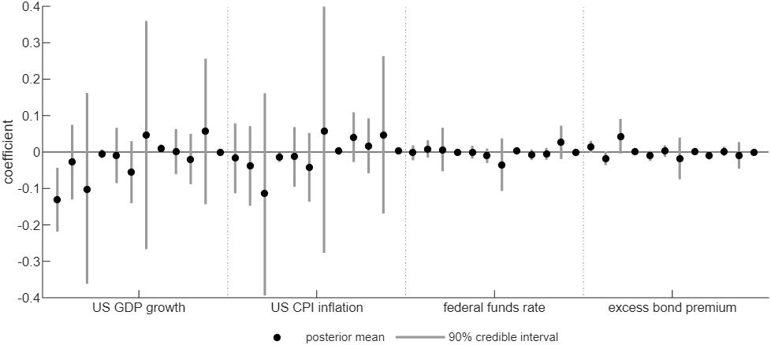

# How to Estimate a VAR for a Small Open Economy

*Code: [`guide.m`](guide.m), with [`bvar.util.build_lags`](../../core/+bvar/+util/build_lags.m),
[`bvar.util.simulate_var`](../../core/+bvar/+util/simulate_var.m) and
[`bvar.priors.resid_var_ar4`](../../core/+bvar/+priors/resid_var_ar4.m). Method:
[Cushman and Zha (1997)](../../CITING.md#cushman-and-zha-1997),
[Zha (1999)](../../CITING.md#zha-1999) and [Chan (2027)](../../CITING.md#chan-2027). Data:
[`soe_Q.csv`](../data/).*

Developments abroad can have large effects on a small open economy, while domestic developments
have little effect abroad. Cushman and Zha (1997) build this asymmetry into a VAR for Canada. The
Canadian variables do not enter the equations for the US and world variables, either in the
current period or with a lag. This restriction is called block exogeneity.

We build a VAR for a small open economy using eight quarterly US and Australian series from
1984Q1 to 2019Q4. Both the domestic and foreign blocks include real GDP growth and CPI inflation.
The foreign (US) block adds the federal funds rate and the excess bond premium. The domestic
(Australian) block adds the 3-month interbank rate and the depreciation of the Australian dollar
against the US dollar. We follow Zha (1999) and estimate the two blocks separately. Specifically,
we first estimate a VAR for the foreign variables. Then we estimate a VAR for the domestic
variables, with the current and lagged foreign variables as exogenous regressors.

We fit the VAR with block exogeneity to these data and use the fitted VAR as the true model. We
simulate a sample from it and draw from the posterior of each block. We then compare the estimates
with those from an unrestricted VAR. In this sample, imposing block exogeneity lowers the mean
absolute error from 0.180 to 0.160, over the US coefficients that both VARs estimate.

To reproduce the numbers and the figure, run the following command from the root of the
repository:

```matlab
run guides/soe_var/guide.m
```

## The Data and the Model

The US block $`\mathbf{y}^f_t`$ contains real GDP growth, CPI inflation, the federal funds rate
and the excess bond premium of Gilchrist and Zakrajšek (2012). The premium is the part of the
spread on corporate bonds that expected defaults do not explain. They interpret a rise in the
premium as a contraction in the supply of credit. The Australian block $`\mathbf{y}^d_t`$ contains
real GDP growth, CPI inflation, the 3-month interbank rate and the depreciation of the Australian
dollar against the US dollar. Growth rates and the depreciation are annualized percentages, and
the rates and the premium are in percent. The data file [`soe_Q.csv`](../data/) contains 144
quarters, 1984Q1 to 2019Q4. The sample starts after the Australian dollar was floated in December
1983 and ends before the pandemic.

With $`p`$ lags and block exogeneity, the VAR is

```math
\mathbf{y}^f_t = \mathbf{a}^f + \sum_{j=1}^{p}\mathbf{A}_j\mathbf{y}^f_{t-j} + \mathbf{u}^f_t, \qquad \mathbf{y}^d_t = \mathbf{a}^d + \sum_{j=1}^{p}\left(\mathbf{B}_j\mathbf{y}^f_{t-j} + \mathbf{D}_j\mathbf{y}^d_{t-j}\right) + \mathbf{u}^d_t,
```

where the errors $`(\mathbf{u}^{f\prime}_t, \mathbf{u}^{d\prime}_t)'`$ are
$`\mathcal{N}(\mathbf{0}, \boldsymbol{\Sigma})`$ with a full $`8 \times 8`$ matrix
$`\boldsymbol{\Sigma}`$. The Australian lags do not enter the US equations. Each lag matrix of the
stacked vector $`\mathbf{y}_t = (\mathbf{y}^{f\prime}_t, \mathbf{y}^{d\prime}_t)'`$ thus has a
$`4 \times 4`$ block of zeros in its upper right corner. Each US equation therefore has $`1 + 4p`$
coefficients, against $`1 + 8p`$ in an unrestricted VAR.

## Step 1: Write the VAR as Two Blocks

The US block is a VAR on its own. For the Australian block, write the Australian errors as
$`\mathbf{u}^d_t = \mathbf{G}_0\mathbf{u}^f_t + \mathbf{e}_t`$, their linear projection on the US
errors plus a remainder $`\mathbf{e}_t`$ that is independent of $`\mathbf{u}^f_t`$. Replacing
$`\mathbf{u}^f_t`$ with the US equation gives

```math
\mathbf{y}^d_t = \mathbf{c} + \mathbf{G}_0\mathbf{y}^f_t + \sum_{j=1}^{p}\left(\mathbf{G}_j\mathbf{y}^f_{t-j} + \mathbf{D}_j\mathbf{y}^d_{t-j}\right) + \mathbf{e}_t, \qquad \mathbf{e}_t \sim \mathcal{N}(\mathbf{0}, \boldsymbol{\Omega}),
```

where $`\mathbf{c} = \mathbf{a}^d - \mathbf{G}_0\mathbf{a}^f`$ and
$`\mathbf{G}_j = \mathbf{B}_j - \mathbf{G}_0\mathbf{A}_j`$. The two blocks have independent
errors, so the likelihood is the product of two likelihoods (Zha, 1999). The first is that of the
US VAR. The second is that of the Australian regression given the US variables. Each block is a
multivariate regression of the form $`\mathbf{Y} = \mathbf{X}\mathbf{B} + \mathbf{E}`$. The
regressors of the US block are the intercept and the US lags. Those of the Australian block are
the intercept, all lags and the current US variables:

```matlab
[Y, Z] = bvar.util.build_lags(data, p);   % x_t = (1, y_{t-1}', ..., y_{t-p}')'
[T, k] = size(Z);
ius = [1, reshape(1 + us' + (0:p-1)*n, 1, [])];   % the intercept and the US lags in x_t
Xus = Z(:, ius);                          % the US block: its own lags
Xau = [Z, Y(:, us)];                      % Australia: all lags and the current US variables
```

Here `us` and `au` index the US and Australian variables in $`\mathbf{y}_t`$. The reduced form
follows from the two blocks. Its coefficients are
$`\mathbf{B}_j = \mathbf{G}_j + \mathbf{G}_0\mathbf{A}_j`$ and
$`\mathbf{a}^d = \mathbf{c} + \mathbf{G}_0\mathbf{a}^f`$, and its error covariance matrix is

```math
\boldsymbol{\Sigma} = \begin{pmatrix} \boldsymbol{\Sigma}^f & \boldsymbol{\Sigma}^f\mathbf{G}_0' \\ \mathbf{G}_0\boldsymbol{\Sigma}^f & \mathbf{G}_0\boldsymbol{\Sigma}^f\mathbf{G}_0' + \boldsymbol{\Omega} \end{pmatrix},
```

where $`\boldsymbol{\Sigma}^f`$ is the error covariance matrix of the US block. The function
`reduced_form` at the end of `guide.m` computes both.

## Step 2: Set the Prior of Each Block

Each block gets the natural conjugate prior of
[How to Choose the Shrinkage of a VAR by the Marginal Likelihood](../natural_conjugate_ml/). For a
block $`\mathbf{Y} = \mathbf{X}\mathbf{B} + \mathbf{E}`$,

```math
(\mathrm{vec}(\mathbf{B}) \mid \boldsymbol{\Sigma}) \sim \mathcal{N}(\mathrm{vec}(\mathbf{B}_0), \boldsymbol{\Sigma} \otimes \mathbf{V}), \qquad \boldsymbol{\Sigma} \sim \mathcal{IW}(\nu_0, \mathbf{S}_0),
```

where $`\boldsymbol{\Sigma}`$ is $`\boldsymbol{\Sigma}^f`$ for the US block and
$`\boldsymbol{\Omega}`$ for the Australian one. The prior mean $`\mathbf{B}_0`$ is zero for the
variables in growth rates. The federal funds rate, the excess bond premium and the Australian
interest rate enter in levels. For each of them the prior mean of the own first lag is one, the
value for a random walk. The diagonal matrix $`\mathbf{V}`$ contains $`c_3 = 10^2`$ for the
intercept and $`c_1/(\ell^2 s_r^2)`$ for lag $`\ell`$ of variable $`r`$. $`\mathbf{S}_0`$ is
diagonal and contains the variances $`s_r^2`$ of the variables of the block. Each $`s_r^2`$ is the
residual variance of an AR(4) fit on the data at hand. We choose the shrinkage hyperparameter
$`c_1`$ by the marginal likelihood.

The shrinkage applies to the lags only. The current US variables in the Australian block get the
prior variances $`1/s_r^2`$ in $`\mathbf{V}`$. The degrees of freedom are $`\nu_0 = 6`$ for
$`\boldsymbol{\Sigma}^f`$ and $`\nu_0 = 10`$ for $`\boldsymbol{\Omega}`$. With these choices, the
error covariance matrix of the VAR has the same prior as in an unrestricted VAR:

```math
\boldsymbol{\Sigma} \sim \mathcal{IW}(n + 2, \mathrm{diag}(s_1^2, \ldots, s_n^2)), \qquad n = 8.
```

This follows from a property of the inverse-Wishart distribution. Let $`\mathbf{S}^f`$ and
$`\mathbf{S}^d`$ be the diagonal matrices of the variances $`s_r^2`$ of the $`n_f = 4`$ US
variables and of the Australian variables. Under the prior above, the three parts of
$`\boldsymbol{\Sigma}`$ in Step 1 have the distributions

```math
\boldsymbol{\Sigma}^f \sim \mathcal{IW}(n_f + 2, \mathbf{S}^f), \qquad \boldsymbol{\Omega} \sim \mathcal{IW}(n + 2, \mathbf{S}^d), \qquad (\mathrm{vec}(\mathbf{G}_0') \mid \boldsymbol{\Omega}) \sim \mathcal{N}(\mathbf{0}, \boldsymbol{\Omega} \otimes (\mathbf{S}^f)^{-1}),
```

and $`\boldsymbol{\Sigma}^f`$ is independent of the other two. The coefficient of Australian
variable $`i`$ on current US variable $`r`$ thus has the prior variance $`\Omega_{ii}/s_r^2`$. The
converse also holds: the three distributions give back the prior of $`\boldsymbol{\Sigma}`$.
[Chan (2022)](../../CITING.md#chan-2022) proves this result for one equation at a time. The code
sets the prior of the two blocks:

```matlab
[VA, B0] = soe_prior(p, n, lev, c1, c3, s2);   % the prior variances and means on x_t
VAus = VA(ius); B0us = B0(ius, us);       % the US block
VAau = [VA; 1./s2(us)];                   % Australia: the current US variables, not shrunk
B0au = [B0(:, au); zeros(nus, nau)];
nu0us = nus + 2; S0us = diag(s2(us));     % Sig_us ~ IW(nu0us, S0us)
nu0au = n + 2; S0au = diag(s2(au));       % Omega ~ IW(nu0au, S0au)
```

Here `lev` indexes the three variables in levels, and the function `soe_prior` returns the prior
variances and means of the coefficients on the intercept and the lags. The posterior of each
block has the same form as the prior:

```math
(\boldsymbol{\Sigma} \mid \mathbf{Y}) \sim \mathcal{IW}(\nu_0 + T, \hat{\mathbf{S}}), \qquad (\mathrm{vec}(\mathbf{B}) \mid \boldsymbol{\Sigma}, \mathbf{Y}) \sim \mathcal{N}(\mathrm{vec}(\hat{\mathbf{B}}), \boldsymbol{\Sigma} \otimes \mathbf{K}^{-1}),
```

where $`\mathbf{K} = \mathbf{V}^{-1} + \mathbf{X}'\mathbf{X}`$,
$`\hat{\mathbf{B}} = \mathbf{K}^{-1}(\mathbf{V}^{-1}\mathbf{B}_0 + \mathbf{X}'\mathbf{Y})`$ and

```math
\hat{\mathbf{S}} = \mathbf{S}_0 + (\mathbf{Y} - \mathbf{X}\hat{\mathbf{B}})'(\mathbf{Y} - \mathbf{X}\hat{\mathbf{B}}) + (\hat{\mathbf{B}} - \mathbf{B}_0)'\mathbf{V}^{-1}(\hat{\mathbf{B}} - \mathbf{B}_0).
```

The function `ncp_post` returns $`\hat{\mathbf{B}}`$, $`\mathbf{K}`$ and $`\hat{\mathbf{S}}`$. Zha
(1999) derives this form under a diffuse prior; the natural conjugate prior keeps it. The marginal
likelihood of each block also has a closed form, which the function `ncp_lml` computes as in the
natural conjugate guide. The prior and the likelihood both split into the two blocks. The log
marginal likelihood of the VAR is therefore the sum of those of the blocks, which the function
`soe_lml` returns.

## Step 3: Choose the Lag Length and the Shrinkage, and Fit the True Model

We choose the lag length and $`c_1`$ by the marginal likelihood, with the AR(4) variances of the
data. For each lag length from one to six, `fminbnd` maximizes the log marginal likelihood over
$`\log c_1`$. Every lag length uses the same 138 quarters:

```matlab
for q = 1:pmax                            % the lag length and the shrinkage
    [Yq, Zq] = bvar.util.build_lags(data(pmax-q+1:end, :), q);   % the same quarters for every q
    [lc, f] = fminbnd(@(lc) -soe_lml(Yq, Zq, us, au, lev, exp(lc), c3, s2d), log(1e-3), log(10));
    c1q(q) = exp(lc); lml(q) = -f;        % the chosen c1 and its log marginal likelihood
end
[~, p] = max(lml);
```

| Lags | 1 | 2 | 3 | 4 | 5 | 6 |
|---|---|---|---|---|---|---|
| Chosen $`c_1`$ | 0.021 | 0.040 | 0.030 | 0.027 | 0.024 | 0.023 |
| Log marginal likelihood | -2106.19 | -2079.39 | **-2075.62** | -2075.79 | -2077.82 | -2079.17 |

The log marginal likelihood is largest at three lags. It is 3.78 above two lags and 0.18 above
four, so three and four lags fit about equally well, and we use three. With three lags, each US
equation has 13 coefficients, against 25 in an unrestricted VAR. The chosen $`c_1`$ lies between
0.021 and 0.040, close to the commonly used $`0.2^2`$. Least squares on each block then gives the
fitted VAR, which is the true model:

```matlab
Bus = Xus\Y(:, us);                       % least squares, block by block
Bau = Xau\Y(:, au);
Uus = Y(:, us) - Xus*Bus;  Sus = Uus'*Uus/(T - size(Xus, 2));
Uau = Y(:, au) - Xau*Bau;  Om = Uau'*Uau/(T - size(Xau, 2));
[Atrue, Sigtrue] = reduced_form(Bus, Bau, Sus, Om, ius, k);   % the reduced form
```

Each covariance matrix divides the residual cross products by the degrees of freedom of its block:
the number of quarters less the number of regressors. The largest modulus of the companion matrix
is 0.863, so the model is stable. The estimates of $`\mathbf{G}_0`$ show how the Australian
variables move with each current US variable, the others held fixed. A rise of one percentage
point in the excess bond premium goes with a 29 percent depreciation of the Australian dollar, at
an annual rate. A rise of one point in the federal funds rate goes with a rise of 0.34 points in
the Australian interbank rate.

[`bvar.util.simulate_var`](../../core/+bvar/+util/simulate_var.m) draws a sample from the true
model, starting from its stationary distribution:

```matlab
q0 = max(p, 4);                           % presample quarters: p lags, four for the AR(4) fits
Yfull = bvar.util.simulate_var(Atrue, Sigtrue, T + q0);     % the presample, then y_1, ..., y_T
[Ys, Zs] = bvar.util.build_lags(Yfull(q0-p+1:end, :), p);   % y_1, ..., y_T and their regressors
```

With three lags, the estimation uses 141 quarters. The sample has as many, plus a presample of
four quarters. The presample provides the lags of the first quarters and the initial observations
of the AR(4) fits of the prior.

## Step 4: Draw from the Posterior of Each Block

The sample gets its own shrinkage, chosen as in Step 3:

```matlab
s2 = bvar.priors.resid_var_ar4(Yfull(1:q0, :), Ys);     % AR(4) variances of the sample
lc = fminbnd(@(lc) -soe_lml(Ys, Zs, us, au, lev, exp(lc), c3, s2), log(1e-3), log(10));
c1 = exp(lc);                             % the shrinkage chosen by the marginal likelihood
```

The marginal likelihood is largest at $`c_1 = 0.070`$, 3.43 log points above its value at
$`c_1 = 0.2^2`$. The blocks are independent in the posterior, so each draw takes one draw from
each block. This is Algorithm 1 of Zha (1999):

```matlab
for r = 1:R
    Sus_d(:, :, r) = iwishrnd(Shat_us, nu0us + T);      % the US block
    Bus_d(:, :, r) = Bhat_us + (Cus'\randn(numel(ius), nus))*chol(Sus_d(:, :, r), 'lower')';
    Om_d(:, :, r) = iwishrnd(Shat_au, nu0au + T);       % Australia, independent of the US block
    Bau_d(:, :, r) = Bhat_au + (Cau'\randn(k + nus, nau))*chol(Om_d(:, :, r), 'lower')';
    A_d(:, :, r) = reduced_form(Bus_d(:, :, r), Bau_d(:, :, r), Sus_d(:, :, r), ...
        Om_d(:, :, r), ius, k);
end
```

Here `Cus` and `Cau` are the lower Cholesky factors of $`\mathbf{K}`$ for the two blocks. The
draws are independent, so no burn-in is needed. `guide.m` takes 10,000 of them.

## Step 5: Compare with an Unrestricted VAR

We fit an unrestricted VAR with a natural conjugate prior. The US coefficients shared by the two
models have the same prior means and variances in both. The error covariance matrix also has the
same prior in both. The unrestricted US equations also include 48 coefficients on Australian lags.
All 48 are zero in the true model. In the unrestricted fit, their posterior means range from -0.13
to 0.06, and four of their 90 percent credible intervals exclude zero (Figure 1).

In this sample, imposing block exogeneity improves the estimates of the US equations. We compute
the mean absolute error of the posterior means over the 52 coefficients that both models estimate.
We leave out the 48 coefficients on Australian lags, which the restricted model sets to their true
value of zero. The error falls from 0.180 to 0.160.

The restriction also changes the posterior of the coefficients that remain in the model. Zha
(1999) points out that it is incorrect to draw from the unrestricted posterior and then set the
Australian lag coefficients to zero. The other coefficients then stay at their unrestricted draws.
In this sample, the posterior means of those coefficients differ between the two models by up to
1.20 posterior standard deviations.



*Figure 1: The coefficients of the four US equations on the Australian lags in the unrestricted
VAR, with their posterior means and 90 percent credible intervals. Each section contains the
twelve coefficients of one equation: the four Australian variables at lags one, two and three.
Their true values are zero.*

## How We Check It

<details>
<summary>Least squares against maximum likelihood, the draws against the posterior, and the prior of the error covariance matrix</summary>

The least squares coefficients of the two blocks, mapped to the reduced form, are the maximum
likelihood estimates of the coefficients of the VAR with block exogeneity. The maximum likelihood
estimates of the covariance matrices divide the residual cross products by $`T`$. The true model
divides them by the degrees of freedom. `guide.m` checks the first-order conditions of the
likelihood on the stacked equations, with the Australian lags removed from the US equations. The
check uses the covariance matrices that divide by $`T`$. Generalized least squares at the
covariance matrix of the block fit returns its coefficients to within 2e-11. These coefficients
return that covariance matrix to within 1e-11.

The means of the draws of each block match $`\hat{\mathbf{B}}`$ to within 0.027 posterior standard
deviations. The means of the covariance draws match the posterior means
$`\hat{\mathbf{S}}/(\nu_0 + T - 5)`$ to within 0.2 percent.

The prior of the two blocks implies the inverse-Wishart prior of $`\boldsymbol{\Sigma}`$ in
Step 2. `guide.m` evaluates the log density of that prior at the true $`\boldsymbol{\Sigma}`$. It
also adds the log densities of the three parts at the true $`\boldsymbol{\Sigma}^f`$,
$`\mathbf{G}_0`$ and $`\boldsymbol{\Omega}`$. The two agree to within 3e-14, after the Jacobian
$`|\boldsymbol{\Sigma}^f|^4`$ of the map from the three parts to $`\boldsymbol{\Sigma}`$.

</details>

## Adapt It Yourself

Cushman and Zha (1997) use four foreign and seven Canadian variables. Which lines of `guide.m`
change when the blocks have other sizes?

<details>
<summary>Answer</summary>

Only the data columns, the variable names, the block sizes `nus` and `nau` and the index `lev` of
the variables in levels, all in Section 1. The index `ius`, the regressors, the prior and
`reduced_form` all follow from them. With $`n_f`$ foreign variables, each foreign equation has
$`1 + n_f p`$ coefficients. The Australian equations have $`1 + np + n_f`$, where $`n`$ is the
total number of variables.

</details>

## Next

[How to Test Block Exogeneity by the Marginal Likelihood](../soe_exogeneity_test/) asks whether
the data support the restriction.
[How to Trace a Foreign Shock through a Small Open Economy](../soe_foreign_shock/) traces a shock
to the US excess bond premium through the Australian economy.

## Using This Method in Your Research

The VAR with block exogeneity for a small open economy follows Cushman and Zha (1997). The
estimation block by block follows Zha (1999). The prior of the error covariance matrix by block
uses a result of Chan (2022). Chan (2027) gives a textbook treatment of the natural conjugate
prior. [`CITING.md`](../../CITING.md) lists the paper behind each function of the toolkit and how
to cite the toolkit itself.

## References

Chan, J. C. C. (2022). Asymmetric Conjugate Priors for Large Bayesian VARs. *Quantitative
Economics*, 13(3): 1145-1169. [doi:10.3982/QE1381](https://doi.org/10.3982/QE1381)

Chan, J. C. C. (2027). *Bayesian Macroeconometrics: Methods and Applications*. Chapman &
Hall/CRC. [Code repository](https://github.com/joshuaccchan/bayesian-macroeconometrics)

Cushman, D. O. and Zha, T. (1997). Identifying Monetary Policy in a Small Open Economy under
Flexible Exchange Rates. *Journal of Monetary Economics*, 39(3): 433-448.
[doi:10.1016/S0304-3932(97)00029-9](https://doi.org/10.1016/S0304-3932(97)00029-9)

Gilchrist, S. and Zakrajšek, E. (2012). Credit Spreads and Business Cycle Fluctuations. *American
Economic Review*, 102(4): 1692-1720.
[doi:10.1257/aer.102.4.1692](https://doi.org/10.1257/aer.102.4.1692)

Zha, T. (1999). Block Recursion and Structural Vector Autoregressions. *Journal of Econometrics*,
90(2): 291-316. [doi:10.1016/S0304-4076(98)00045-1](https://doi.org/10.1016/S0304-4076(98)00045-1)
